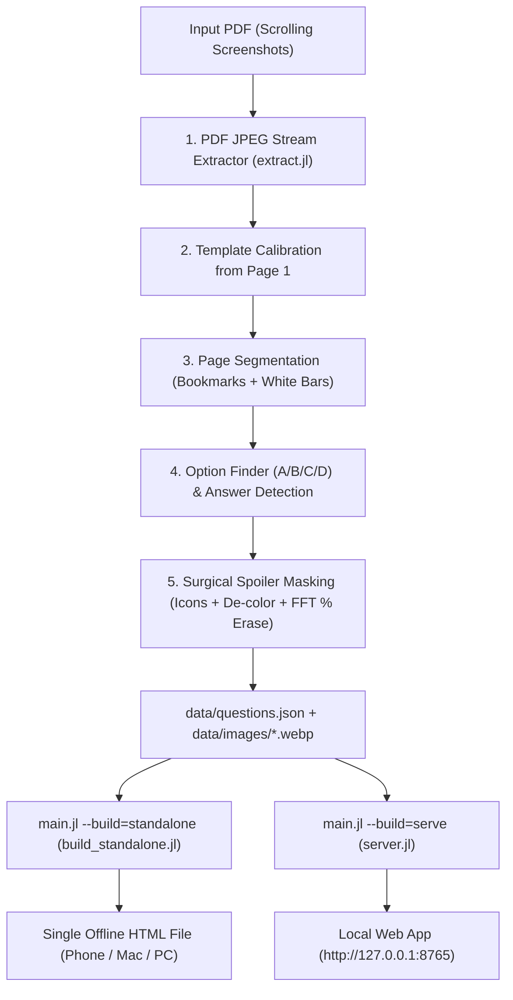

# Snap2Q — How the Pipeline Works (Complete Guide)

This document explains **everything** happening under the hood of Snap2Q — from a raw PDF full of tall scrolling mobile screenshots to an interactive, spoiler-free offline QBank web app — written so anyone can follow along even with zero background in image processing, PDFs, or Julia.

---

## 1. The Core Problem & Why We Don't Use OCR

When you export a QBank review screen as scrolling mobile screenshots into a PDF:
- There is **no selectable text** — every page is just a tall raster image (`1080px` wide × `10,000–19,000px` tall) containing ~5 questions stacked vertically.
- The **correct answer is visually spoiled** in four ways:
  1. A **green checkmark** icon next to the correct option.
  2. A **red X** icon next to a wrong user attempt.
  3. The correct option's **text is colored green** instead of neutral grey.
  4. Every option ends with a **`[XX%]` poll badge** (e.g. `[67%]`) that immediately gives away the majority answer.
- Many questions and explanations contain **diagrams, graphs, ECGs, chemical formulas, tables, and clinical photos**.

### Why Image-Masking Beats Full OCR Here
Running OCR (converting images into text) risks misreading drug names, doses (`µg` vs `mg`), receptor subscripts (`α₁`, `β₂`), and requires a separate layout-detection step to crop out plots and re-attach them.

Instead, Snap2Q uses **surgical pixel-level segmentation & spoiler masking**:
- Keep every question stem, diagram, explanation, and textbook reference as a **crisp original image** (zero OCR typos, 100% intact diagrams).
- Automatically detect which option (`A`/`B`/`C`/`D`) is correct by reading the green markers.
- Cleanly **erase or recolor only the answer spoilers** inside the options area so the question looks completely unattempted.

---

## 2. High-Level Pipeline Architecture



All orchestration is handled by [main.jl](main.jl), which calls modular Julia scripts inside `analysis/`.

---

## 3. Step-by-Step Breakdown

### Step 1: Reading Page Images Directly from the PDF (`index_pdf_jpegs`)
A PDF file is a container of numbered objects. When a screenshot-to-PDF tool stitches JPEG screenshots into a PDF, it embeds each JPEG untouched inside a stream object:

```text
<< /Type /XObject /Subtype /Image /Filter /DCTDecode /Length 4633573 ... >>
stream
<raw JPEG bytes starting with FF D8 ... ending with FF D9>
endstream
```

Because every page is a raw `/DCTDecode` JPEG, `analysis/extract.jl` doesn't need any heavy external PDF rendering engine (like Poppler or MuPDF):
1. `index_pdf_jpegs` scans the PDF bytes for `/Subtype /Image` dictionaries containing `/DCTDecode`.
2. It reads `/Length` to record the exact `(byte_offset, byte_length)` of every page's JPEG stream in order.
3. Worker threads seek directly to each page's offset and decode the JPEG into `R`, `G`, `B` byte matrices (`UInt8`) using `JpegTurbo.jl` (`libjpeg-turbo`).

---

### Step 2: Self-Calibrating Pixel Templates (`build_templates`)
Because all screenshots come from the same mobile app rendered at the exact same `1080px` width and font, UI icons and option labels are **pixel-for-pixel identical** across all pages.

On startup, `build_templates` crops small reference patches directly from Page 1:
- **Bookmark icon** (`54×34` px at the top-right of Question 1) — marks the start of every question.
- **Option letters `A.`, `B.`, `C.`, `D.`** (`34×46` px each at `x = 121..166`).
- **Percentage badge glyphs `%]`** (`32×30` px) and **`[`** (`32×10` px).

#### Color-Invariant Ink Representation
Option letters and `[XX%]` badges can be either neutral grey or green. To match both identically with one template, `to_ink_alpha` converts any RGB patch on the `#F7F7F7` (`247`) background into a single grayscale "ink strength" in `[0.0, 1.0]`:

$$\text{ink}(y, x) = \text{clamp}\left(\frac{\max(|R - 247|, |G - 247|, |B - 247|)}{118},\; 0,\; 1\right)$$

Both neutral grey (`|126 - 247| = 121`) and green (`|50 - 247| = 197`) saturate cleanly to `1.0` on solid strokes and `0.0` on background.

---

### Step 3: Splitting Each Tall Page into Questions & Explanations
Each page contains ~5 questions stacked vertically. We split them using two ultra-reliable visual landmarks:

1. **Question Starts (`find_bookmarks`):**
   - Slides the `54×34` bookmark template down the narrow right-margin strip (`x = 977..1010`).
   - Computes Mean Absolute Error (MAE) at every row `y`. Every row with `MAE < 12` (grouped by proximity) gives the exact `y`-coordinate of a question header.
2. **Question-to-Explanation Split (`find_white_bars`):**
   - Immediately below every question's options is a pure-white horizontal banner (`"XX% of the people got this right"`, `RGB ≈ (255, 255, 255)`, height ~`115px`), sandwiched between `#F7F7F7` (`247`) above and below.
   - Scanning the right margin (`x = 1021..1075`) for contiguous runs of 80–145 rows with mean brightness `> 252.5` pinpoints every white bar with zero false positives.
3. **Cropping:**
   - **Question + Options:** from `bookmark_y - 42` down to `white_bar_start - 1`.
   - **Explanation + Reference:** from `white_bar_start` down to `next_bookmark_y - 48` (or bottom of page, trimming trailing blank `#F7F7F7` padding).

---

### Step 4: Locating Options (`A`–`D`) & Detecting the Correct Answer
Inside each cropped Question + Options image:

1. **Finding `A.`, `B.`, `C.`, `D.` (`find_option_ys`):**
   - Slides the `A.`, `B.`, `C.`, `D.` ink templates down the option-letter column (`x = 117..170`) in strictly increasing vertical order (`y_A < y_B < y_C < y_D`).
   - **Why this matters for diagrams:** The vertical position of Option `A.` (`opt_top = y_A - 22`) marks the exact boundary between the **question stem (and any diagrams)** and the **options area**. Everything above `opt_top` is left **100% untouched**, so green colors inside plots, ECGs, or clinical photos are never altered.
2. **Detecting the Correct Answer (`detect_correct_answer`):**
   - Divides the options area into 4 vertical bands (one per option).
   - Counts "green" pixels (`G - R > 12` and `G - B > 38`) in two separate zones:
     - **Left icon gutter** (`x = 56..115`, where the green checkmark sits).
     - **Option text area** (`x = 119..1050`, where the green option text sits).
   - If the option with the green checkmark matches the option with green text, it assigns `confidence = 1.0`.

---

### Step 5: Surgical Spoiler Masking (`mask_question_spoilers`)
Now that we know the correct answer and `opt_top`, we clean all spoilers **only in `y >= opt_top`**:

#### A. Erasing Checkmarks & Red Xs
The left icon gutter (`x = 46..116`, `y >= opt_top`) is filled with flat background `#F7F7F7` (`RGB(247, 247, 247)`).

#### B. De-coloring Green Option Text (Without Looking Bold!)
Simply replacing green pixels with solid grey makes letters jagged. Even worse, naive linear remapping makes the recolored option look **slightly bolder/heavier** than the other three options — a subtle visual spoiler.

Why did naive remapping look bold?
1. Pure green ink reaches `B ≈ 50` (span `247 - 50 = 197`), not the median pixel `B ≈ 78`. Dividing by a smaller span clamps soft anti-aliased edge pixels to `1.0` (full darkness), artificially thickening every stroke.
2. JPEG `4:2:0` chroma subsampling blurs color channels (`Cb`/`Cr`) slightly wider than luminance (`Y`), creating a faint green halo around letters.

**The fix:**
For every green pixel (`G - R > 4`, `G - B > 10`, `B < 244`):
1. Recover its true anti-aliasing opacity with a `1.35` gamma curve to counter chroma bleed:
   $$\alpha = \text{clamp}\left(\frac{247 - B}{197},\; 0,\; 1\right)^{1.35}$$
2. Re-blend that exact `α` with the neutral option grey (`126`) over `#F7F7F7` (`247`):
   $$\text{gray} = \text{round}\big(247 \cdot (1 - \alpha) + 126 \cdot \alpha\big)$$
3. Set `R = G = B = gray`.

The result matches the exact stroke weight, anti-aliasing, and tone of the other three options.

#### C. Erasing `[XX%]` Poll Badges with 2D FFT (`erase_percentages!`)
Options end with poll stats like `[8%]`, `[67%]`, or `[100%]` at arbitrary `(x, y)` positions depending on line length and wrapping.

A naive 2D sliding-window loop comparing a `32×30` template across a `400×965` region would allocate gigabytes or run slowly. Instead, we use the **Fast Fourier Transform (FFT)** identity for Sum of Squared Differences (SSD):

$$\text{SSD}(y, x) = \sum (I - T)^2 = \underbrace{\sum I^2}_{\text{2D integral image}} + \underbrace{\sum T^2}_{\text{constant}} - 2 \cdot \underbrace{(I \star T)}_{\text{2D FFT cross-correlation}}$$

1. **Local energy $\sum I^2$** for every `32×30` window is computed in $O(H \cdot W)$ using a 2D cumulative-sum (integral) image.
2. **Cross-correlation $I \star T$** is computed in ~2 milliseconds via `FFTW.irfft(rfft(I) .* rfft(flipped_T))`.
3. Every local minimum with `MSE < 0.045` locates an exact `%]` glyph (non-maximum suppressed so each badge is matched once).
4. For each `%]`, we scan 12–95 px to the left on the same row for the matching `[` template, then paint the exact bounding box `[left_x - 5 .. right_x + 4, y - 4 .. y + 35]` with `#F7F7F7`.

---

### Step 6: Diagram Tagging, WebP Compression & Julia Performance Notes
- **Diagram Detection (`detect_has_diagram`):** Inspects the question stem *above* `opt_top` for rich color saturation (`> 1,200` saturated pixels) or tall dense dark regions (`> 180` rows), tagging `has_diagram: true` in `questions.json` so users can filter by diagram questions.
- **Output:** Saves every question and explanation as lossy WebP (`quality = 85`) in `data/images/` and writes metadata to `data/questions.json`.
- **Three Julia Engineering Details that Made Extraction Fast & Crash-Free:**
  1. **Concrete JPEG Decode Type:** Calling `JpegTurbo.jpeg_decode(RGB{N0f8}, buf)` instead of untyped `jpeg_decode(buf)` eliminated 140 million boxed heap allocations per page (~500× speedup on page loading).
  2. **Single-Threaded FFTW inside Multi-Threaded Julia:** Setting `FFTW.set_num_threads(1)` prevents `N × N` thread oversubscription when `Threads.@threads` processes multiple pages in parallel.
  3. **Safe Multi-Threaded WebP Encoding:** `WebP.jl` v0.1.3 defaults to lossless encoding and passes `pointer(image)` to C without `GC.@preserve`. Pre-transposing `img_t = permutedims(img, (2, 1))` and calling `GC.@preserve img_t WebP.encode(img_t; lossy=true, quality=..., transpose=true)` enables fast lossy WebP and eliminates GC segfaults completely.

---

### Step 7: Delivery Modes (`main.jl`)

Snap2Q supports two target modes controlled by `--build`:

1. **`--build=standalone` (`analysis/build_standalone.jl`):**
   - Decodes each WebP in `data/images/`, downscales it to a crisp mobile-friendly width (default `680px`) using a custom pure-Julia bilinear resizer, re-encodes to compact lossy WebP (default `quality = 65`), and Base64-encodes it.
   - Inlines `web/styles.css`, `web/app.js`, `window.QBANK_DATA`, and `window.QBANK_IMAGES` directly into **one single self-contained `.html` file** (`dist/pharma-qbank-standalone.html`).
   - Runs 100% offline on Android, iOS, iPad, Mac, or Windows with zero server and zero `fetch()` CORS issues.

2. **`--build=serve` (`analysis/server.jl`):**
   - Starts a lightweight multi-threaded `HTTP.jl` server serving `web/` at `/`, `data/` at `/data/` (with `Cache-Control` for images), and `/api/progress` (`GET`/`POST`) to persist progress to `data/progress.json`.

---

### Step 8: Interactive Frontend (`web/`)
The browser UI ([index.html](web/index.html), [styles.css](web/styles.css), [app.js](web/app.js)) is vanilla JavaScript with zero external frontend dependencies:
- **Auto-detects mode:** Uses `window.QBANK_DATA` + Base64 data URIs when opened as a standalone HTML file, or `fetch("/data/questions.json")` when served by `server.jl`.
- **Modes:** Practice Mode (instant feedback + explanation reveal) and Exam Mode (live timer, hidden answers until submission).
- **Study Tools:** Filters (All / Unattempted / Incorrect / Correct / Bookmarked / Diagrams), Shuffle, 100-item paginated Navigator Grid, Jump by Q# or PDF Page, Click-to-Zoom diagram lightbox, Dark Mode, Personal Notes per question, and Keyboard Shortcuts (`A`–`D` / `1`–`4`, `←`/`→`, `E`, `S`, `Z`, `G`).
- **Progress Persistence:** Auto-saves to `localStorage` (and `data/progress.json` in server mode), with **Export JSON**, **Import JSON**, **Reset All Responses** (keeps bookmarks & notes), and **Reset Everything**.
